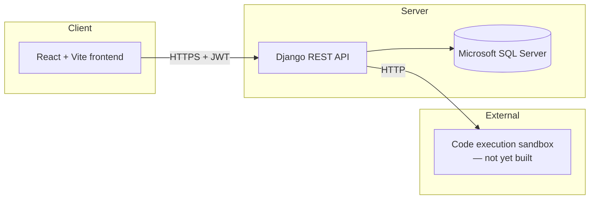
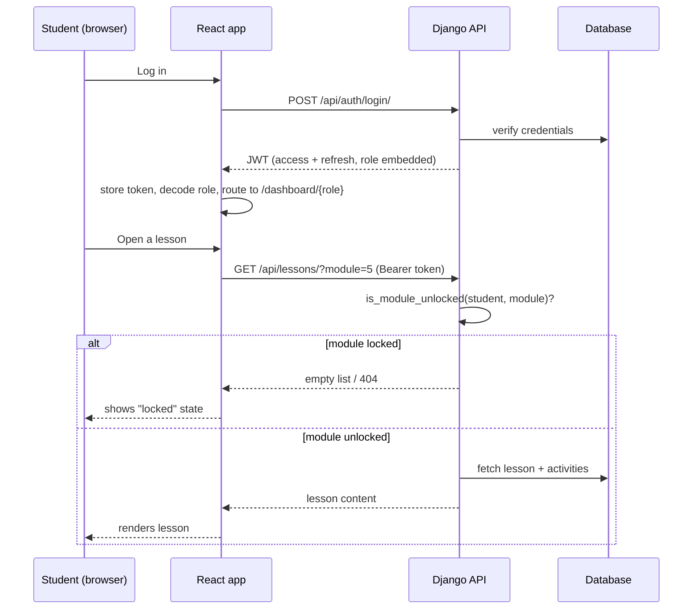
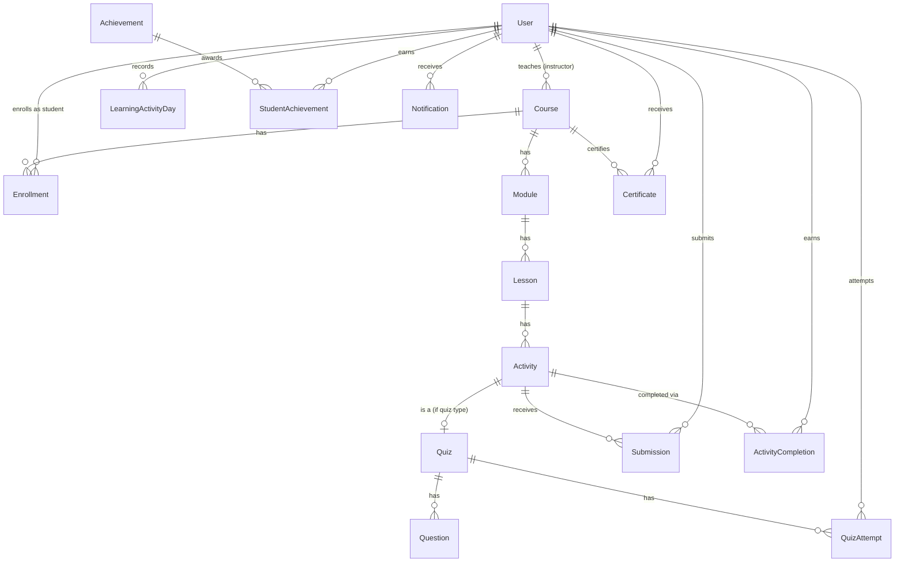
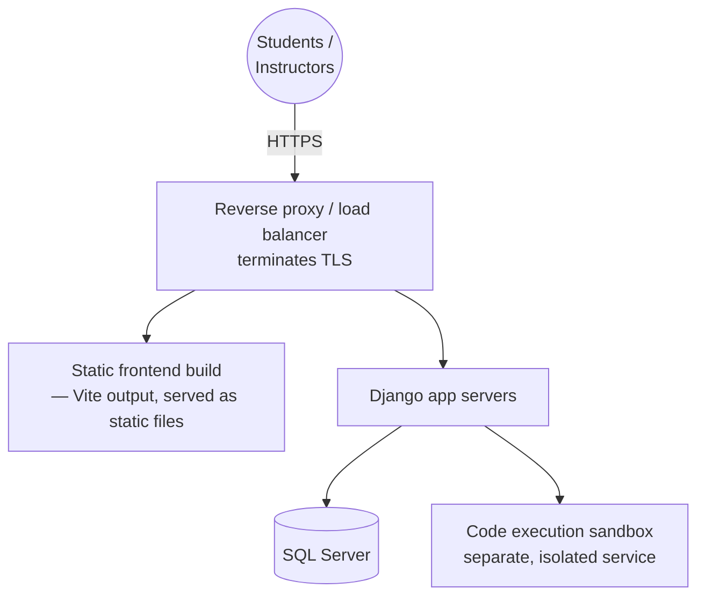

# Architecture — Optimum ERP LMS

## System overview



This matches the brief's required architecture (section 16):
Frontend → REST API → Backend → Database, with a separate sandbox for
running student code. The sandbox is deliberately **not** part of this
codebase — see "Why the sandbox is external" below.

## Request flow, end to end



The key point: **the lock check happens on the server, on every request**,
not once at login. A student can't cache a URL from when a module was
unlocked and keep using it — well, they can, actually, since unlocking is
permanent once earned; the point is a student can never GET *ahead* of
where they've legitimately earned access, no matter what the frontend
shows or hides.

## Backend: one Django app per domain

```
backend/apps/
├── accounts/      User model, JWT auth, role-based permission classes
├── courses/       Course → Module → Lesson → Activity (the content tree)
├── enrollment/    Student ↔ Course
├── progress/      Module-locking logic (services.py) + ActivityCompletion
├── engagement/    Study-day streaks, achievement awards, notifications, certificates
├── submissions/   Lab/assignment submissions, attempt limits, grading
├── quizzes/       Quiz, Question, auto-grading
├── execution/     Thin client to the external sandbox — no models
├── dashboards/    Read-only aggregation and weekly performance snapshots
├── risk/          Early warning scoring over performance snapshots
├── sequencing/    Database-derived next-step recommendations
└── allocation/    Admin workload allocation recommendations
```

**Why split this way, not by technical layer:** a folder per domain (not
one giant `models.py` / `views.py` for the whole project) means an
instructor-facing feature and a student-facing feature rarely touch the
same file, which matters once more than one person is working on this —
see the team-of-10 discussion earlier in this build for the reasoning.

**Why `progress/services.py` is separate from `progress/views.py`:** the
actual locking rules (`is_module_unlocked`, `is_module_complete`,
`mark_activity_complete`) are plain Python functions, not tucked inside a
view. `submissions/views.py` and `quizzes/views.py` both `import` and
call `mark_activity_complete` directly — completion logic lives in
exactly one place, not reimplemented per app. This also makes the rules
testable on their own, without spinning up HTTP requests.

## Data model



`ActivityCompletion` (in the `progress` app) is the single source of
truth for "has this student finished this activity" — `submissions` and
`quizzes` both write to it when work passes, and `progress/services.py`
reads from it to decide what's unlocked. Nothing else duplicates a
"completed" flag.

The `engagement` app consumes those completion events and verified video-watch
increments. It stores one study day per learner/date, idempotent achievement
awards, recipient-scoped notifications, and certificate issuance/revocation
history. Course completion is still decided by the existing progress service;
engagement does not introduce a competing completion rule.

## Authentication & authorization

- **JWT**, via `djangorestframework-simplejwt`. Access token: 15 minutes.
  Refresh token: 7 days.
- **Role lives on the User model** (`student` / `instructor` / `admin`),
  embedded in the JWT payload so the frontend can route without an extra
  round-trip.
- **Permission classes** (`apps/accounts/permissions.py`) are shared
  across every app — `ReadOnlyOrInstructorAdmin` is the most common
  pattern: anyone authenticated can read, only instructor/admin can write.
- **Public registration always creates a student** — role escalation is
  only possible through Django admin, by someone who already has admin
  access. This was a real bug caught during testing (see
  `backend/README.md`), not a hypothetical.

## Frontend structure

```
frontend/src/
├── lib/api.js              Single point of contact with the backend —
│                            attaches JWT, handles 401s, one place to
│                            change the API base URL
├── context/                Auth state (who's logged in, what role)
│   ├── auth-context.js      the React context object
│   ├── AuthContext.jsx      the provider component
│   └── useAuth.js           the hook — split from the provider so
│                             Vite's fast-refresh works cleanly
├── components/
│   ├── DashboardLayout.jsx  shared sidebar+topbar shell, takes navItems
│   │                        as a prop so each role owns its own nav
│   └── ProtectedRoute.jsx   redirects unauthenticated/wrong-role users —
│                            a UX convenience, NOT the real security
│                            boundary (that's server-side, see API docs)
├── pages/
│   ├── Login.jsx
│   ├── StudentDashboard.jsx     fetches /api/dashboard/student/
│   └── InstructorDashboard.jsx  fetches /api/dashboard/instructor/
└── Landing.jsx              public marketing page
```

**Why `ProtectedRoute` is explicitly documented as not-the-real-boundary:**
it's tempting to think hiding a route client-side is "enough" security.
It isn't — anyone can call the API directly with curl, bypassing the
React app entirely. The actual enforcement is 100% server-side (Django
permission classes + the module-locking checks). `ProtectedRoute` only
exists so a logged-in student doesn't see a confusing instructor UI
shell; it has zero bearing on what data they can actually get.

## Why the sandbox is external, not part of this codebase

Brief section 6 requires code execution to be **isolated from the main
application** so unsafe student code can't affect the platform. Running
arbitrary student code inside the same Django process that also holds
grades, auth, and everything else would defeat that requirement entirely.
`apps/execution/views.py` is a thin proxy — it forwards to `SANDBOX_URL`
and returns whatever that service reports, nothing more. Standing up the
actual sandbox (Judge0, Piston, or a custom Docker-based runner) is
separate infrastructure work, not a Django app.

## Deployment topology (target — not yet deployed)



Django's `SECURE_SSL_REDIRECT` / HSTS settings (in `config/settings.py`,
active when `DEBUG=False`) assume this shape: something in front of
Django terminates real TLS and forwards `X-Forwarded-Proto` — Django
itself doesn't generate certificates.

## Scaling notes for 3,000+ students

Called out here because it's an architecture concern, not a bug:

- `InstructorDashboardView`'s "falling behind" calculation loops over
  every enrolled student per course. Fine at current scale, worth
  revisiting with a cached/precomputed version (e.g. a nightly job that
  writes a `falling_behind` flag) before this becomes the slow part of
  the instructor dashboard.
- `ActivityCompletion` has a composite index on `(student, activity)` —
  this is the table module-locking checks hit on nearly every
  content-serving request, so it's indexed deliberately, not by accident.
- SQL Server connection pooling matters at this scale — `mssql-django`
  respects Django's standard `CONN_MAX_AGE` setting; not yet tuned in
  `config/settings.py`, worth revisiting once there's a real staging
  environment to load-test against.
